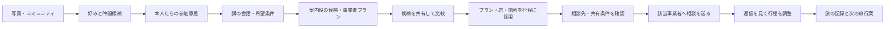

# 「講」旅行者・事業者・案内役の画面設計

更新：2026年11月9日。**追加設計案。稼働確認中の画面コードは変更していない。**

写真コミュニティと人同士の仲間探しを入口に、講の中で希望をまとめ、旅行案・事業者のプランを比較し、選んだ相手と相談できるところまでをつなぐ。ローカルReact/Python/Docker、本人認証、日本語、スマホ対応を継続する。`MARKETPLACE-CONTRACT.md` 設計案0.1と照合済み。代表者権限・同時相談数等は親担当の確定前であり、実装完了を示さない。

契約0.1に合わせる初版案は、代表者が条件確定と共有送信を行い、1計画につき有効な事業者選択は1件とする。選び直すと旧相談を終了し、改めて共有内容を確認する。複数社同時の相見積もりや全員一致の投票決定は実装を前提にしない。「行程に採用」は送信前の下書き、`selection-preview` はまだ非開示、`selections` で明示送信後に選択と相談を同時作成する。

## 1. 三つの役割と情報の境界

| 役割 | できること | 他者へ伝える前の確認 |
|---|---|---|
| 旅行者 | 写真・好みの共有、仲間への参加、講の会話、条件入力、候補保存・採用、行程編集、事業者との相談 | 好みの利用許可、候補参加、旅行への参加、事業者へ相談する意思を分ける |
| 事業者 | 自社プランの下書き・公開、人数/泊数/費用等の条件設定、自社へ届いた相談への返信 | 公開プランの内容を確認。旅行者の元写真・私的な好み・別の相談は閲覧しない |
| 案内役（AIハブ） | 本人入力と許可された好みから条件を整理し、候補・一致理由・未確認事項を提示 | 人に代わって採用・参加・相談送信・予約確定しない |

案内役は権限を持つ旅行者・事業者アカウントと混同しない。候補作成の結果と人間の発言は見た目と送信者名で区別する。ローカルモデルで処理できない場合は手入力・条件検索を残し、推論したふりをしない。

**事業者への接続は、対象の選択後だけ。** 「候補に保存」「行ってみたい」の反応だけで事業者へ通知しない。採用したプラン・店・場所を起点に、相談先と送る条件を確認し、本人が「相談を送る」を押した時点で相談を作る。

## 2. 画面構造と遷移

旅行者の主ナビは「みんなの記録」「旅を見つける」「わたしの講」。好み・公開許可は本人メニュー、投稿は目立つ追加ボタンにまとめる。事業者でログインした場合は「プラン」「届いた相談」「事業者情報」。ロールを選ぶだけで他者の権限に切り替えない。

同じ講に「会話」「候補」「行程」を置き、別アプリを行き来させない。一般の個人DMは追加しない。講のメンバー内会話と、個別事業者との相談スレッドを明確に分ける。

## 3. 重点画面A：旅行者の発見

**最初に分かること：誰と、どんな条件で、どこへ行く候補なのか。**

- 上部：現在のコミュニティ/講、短い見出し「次は、どこへ行こう」、人数・泊数・予算の条件帯。確定値と未入力を分ける。
- 中央：写真が大きい主候補1件、その下に2〜3件の比較候補。すべて同じ大きさのカードにしない。場所、時期、対応人数、泊数、概算費用、作成者を短く表示する。
- 候補の理由：「森歩き・カフェが共通」「6人・2泊の条件に合う」など根拠のある内容を最大3点。未入力や未確認は一致と数えない。
- 「案内役が組み合わせた案」と「事業者が公開したプラン」を小さな作成者表示で区別。AIを目立つバッジで散らさない。
- 主操作：「講の候補に追加」。詳細では日別行程、含まれる費用/含まれない費用、人数条件、店・場所を確認する。まだ相談は送られない。
- PCは左ナビ、中央の写真と候補、右に講の条件・保存した候補。スマホは写真→理由→条件→操作の順で単列化する。

条件変更時は古い結果を新条件に合うように見せない。「条件を変更しました。候補を更新してください」と表示し、結果の条件版を保持する。候補がない場合は、人数・泊数・予算のうちどの条件が合わなかったかを説明し、変更へ戻せる。

## 4. 重点画面B：講の旅行計画と相談

**最初に分かること：何が決まり、何をみんなで決める必要があるか。**

上部に講の目的、参加者、旅行条件、希望日を固定する。「想定6人」と「参加確認済み3人」を区別し、人数入力だけで会員を作らない。30人以上の団体も同様で、同行予定人数と登録参加者数を混ぜない。

| 部分 | 表示と操作 |
|---|---|
| 会話 | 発言者・時刻・本文。候補カードを引用して相談できる。案内役の条件整理は人間のメッセージと分け、利用者が採用/修正する |
| 候補 | 写真、場所、費用、条件、保存した人。自分の「行ってみたい」を変更・撤回可能。反応数を旅行参加や予約と数えない |
| 行程 | 「1日目・2日目・3日目」のまとまり、訪問先、目安時刻、移動・費用の未確認事項。追加/削除/上下ボタンで編集でき、ドラッグ必須にしない |
| 持ち寄ること | 食事を探す、移動を調べる、写真をまとめる等。未選択でも参加可 |
| 事業者への相談 | 採用済み対象から相談先を選択。相談先ごとに独立スレッド。別事業者に会話が見えない |

PCは中央に行程/候補、右に会話と相談先切替。スマホは「会話・候補・行程」の同一講内切替とし、入力欄が下部ナビ・キーボードに隠れないようにする。切替時に未送信の文章を勝手に送らない。

相談前の確認には「誰に」「何を送るか」を表示する。初期共有は講の目的、人数、泊数、希望日、予算、採用対象、本人が入力した質問に限る。相談中の発言者の表示名も相手に見えることを示す。元コミュニティ名、私的な会話、全写真、個々の嗜好履歴、辞退理由は送らない。送信後は「相談中」であり「予約済み」とは表示しない。

予算欄は「1人あたり/全員分」と「プラン部分/旅行全体」を別々に選ぶ。未入力を0円扱いせず、交通費等が含まれる範囲の違う費用を適合と断言しない。参加代表者1人の家族・団体計画は「代表者が計画中」と表示し、「全員が承諾した講」と表示しない。

## 5. 重点画面C：事業者のプラン編集

**最初に分かること：誰向けの旅を、どの条件で提案するのか。**

- PCは左に項目ナビ、中央に入力、右に旅行者向けプレビュー。スマホは「編集/プレビュー」の切替。
- 入力順は「表紙と説明 → 対象・条件 → 日別の行程 → 費用 → 公開確認」。下書き保存を常に用意する。
- 基本項目：タイトル、地域、写真、旅行の目的、対応人数の下限/上限、泊数、費用単位、概算額、含むもの/含まないもの、時期、相談で確認する事項。
- 日別行程：店・場所・体験を追加。未登録の場所は説明入力として扱い、存在や営業時間を確認済みと見せない。並び替えは上下ボタンでも操作可能。
- 公開前に旅行者と同じ表示を確認。「公開する」を押すまで検索候補に出ない。自社以外のプランを編集する入口を出さず、APIでも拒否する。
- 相談一覧は「新着・相談中・終了」、相談詳細には共有された旅行条件と対象プランを置く。返信を送っただけで旅行者の行程や条件を上書きしない。

## 6. 二つの代表プラン

以下は操作検証用の架空の企画例。価格・営業・受入可否が確認済みの商品ではない。

| 例 | 条件と構成 | 確かめる体験 |
|---|---|---|
| 6人で軽井沢、2泊3日 | 森歩き・カフェ・食事。1日目は街歩き、2日目は自然体験、3日目は買い物。予算は1人あたり旅行全体の概算を明示 | 仲間の希望→日別候補→店・場所の採用→選んだ事業者だけに相談 |
| 30人以上の修学旅行 | 例：32人・2泊3日。体験学習、団体食事、移動の余裕。対応人数・団体受入・行程時間を重視 | 人数を増やすと小規模プランが対象外になり、団体向けプランを比較できる。引率者が質問を送る |

子どもの氏名、顔写真、健康情報を候補検索の必須条件にしない。団体旅行の計画条件だけで検証できるようにする。現行3〜6人の仲間推薦と、団体プランの想定人数は別概念としてAPI契約を分ける。

## 7. 仕上げと受入条件

- 暖色の生成り `#faf6ef`、朱茶 `#a9472d`、濃茶 `#32281f`、補助のセージを継続。写真・明確な余白・短い日本語見出しを主役にする。和柄や制作側の説明を散らさない。
- 主要操作は44px以上、フォーカス可視、色以外の選択表示、文字200%、幅320px、動きを減らす設定、キーボードで最後まで操作できることを確認する。
- 保存・送信中は二重操作を防止。失敗時は入力を保持し、勝手に再送しない。画面やアカウントの切替で別人の下書きを表示しない。
- 6人2泊3日の条件で候補を作成し、候補保存だけでは事業者の相談一覧が増えないことを検証する。
- 対象を採用し、共有内容を確認して相談送信した後、該当事業者だけが閲覧・返信できることを検証する。未選択事業者・他の講・他社プランへの直接API操作も拒否する。
- 人数32人に変更し、人数上限6人のプランが適合扱いにならないことを検証する。適合プランなしの状態も用意する。
- プラン編集の下書き/公開、所有者制限、同時編集の競合、相談の重複送信、再起動後の保持を確認する。
- 投稿/好み→仲間参加→条件→候補→採用→事業者相談→行程更新を一連の動線で確認する。候補閲覧・相談件数を実旅行や再訪の達成と報告しない。

予約・決済・空席確認・外部通知・公開DMは今回の追加範囲に含めない。候補への反応/メモは参考案であり、API未対応のまま押せるだけのボタンを置かない。

## 8. 公式事例から採用する行動単位

| 公式資料（2026年11月9日確認） | 確認した行動 | 講での採用 |
|---|---|---|
| [Airbnb：ウィッシュリスト](https://www.airbnb.com/help/article/1236) | 共同候補、メモ、賛否、日程・人数の編集 | 講内で候補を比べ、条件を共同で育てる。公開リンク共有の権限方式は流用しない |
| [LINE：アルバム](https://help.line.me/line?contentId=20000248) | 友人・グループ内の写真整理 | コミュニティと公開先が分かる写真導線 |
| [Meta：コラボコレクション](https://about.fb.com/ja/news/2023/03/collaborativecollection/) | 参加者がそれぞれ気に入った投稿を共通の保存先へ追加 | 個人の発見を、講の候補へ持ち寄る |
| [Uber：Group rides](https://www.uber.com/us/en/ride/group-rides/) | 招待された本人が自分の乗降場所を追加 | 各人が自分の希望・行程情報を加える。代表者が全員の意思を推測しない |

ブランドのロゴ・配色・画面を複製する設計ではない。上記の行動を講の目的、任意参加、協力、選択後の事業者相談に合わせて組み直す。外部サービスとのAPI連携はしない。
