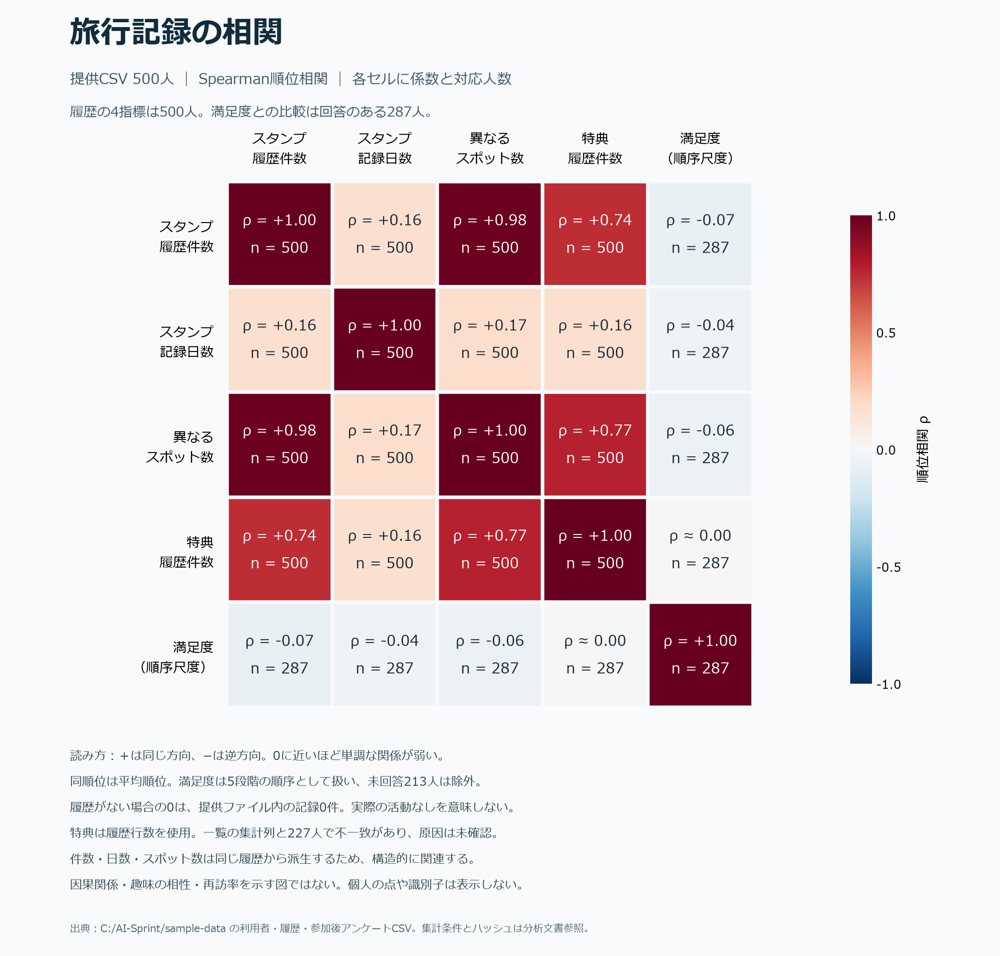

# 閉じた旅行コミュニティ構想に向けたサンプル分析

## 確認した事実

実読込時刻（UTC）：2026-11-09T04:58:03.876757+00:00。参照元は `C:/AI-Sprint/sample-data`。今回、5CSVを全行読み込み、旧集計の転記ではなく再集計した。元ファイルは読込前後のSHA-256が5件とも一致した。

| ファイル | 行数 | 異なる利用者ID数 | ユーザー一覧と未対応のID数 |
|---|---:|---:|---:|
| 08_アンケート回答_参加後.csv | 287 | 287 | 0 |
| 09_アンケート回答_登録時.csv | 500 | 500 | 0 |
| 12_スタンプ獲得履歴.csv | 2,629 | 480 | 0 |
| 13_ユーザー一覧.csv | 500 | 500 | 対象外 |
| 18_特典獲得履歴.csv | 584 | 355 | 0 |

ユーザー一覧の重複ID行は0件、登録時回答の重複ID行は0件。IDの列名は異なるため、下記の対応で照合した。氏名・メール・LINE個人IDによる照合は行っていない。

| ファイル | 照合列 |
|---|---|
| 08_アンケート回答_参加後.csv | `user_id` |
| 09_アンケート回答_登録時.csv | `user_id` |
| 12_スタンプ獲得履歴.csv | `ユーザID` |
| 13_ユーザー一覧.csv | `ユーザーID` |
| 18_特典獲得履歴.csv | `user_id` |

### 確認した列名

以下は列の名前のみ。氏名・連絡先・LINE個人IDの値、自由記述原文、個票は記載しない。

- **08_アンケート回答_参加後.csv**：`user_id`、`user_name`、`is_line`、`アンケート①(満足度を教えてください)`、`アンケート②（旅で良かった点）`、`アンケート③（要望がありましたら）`
- **09_アンケート回答_登録時.csv**：`user_id`、`user_name`、`is_line`、`2488_性別`、`2489_年齢`、`2528_居住地`、`2529_職業`、`何で知りましたか？（複数選択可）`
- **12_スタンプ獲得履歴.csv**：`ユーザID`、`RAUND管理ユーザ名`、`ユーザ名`、`LINEログイン`、`周回`、`スタンプ名`、`スポット名`、`獲得日時`
- **13_ユーザー一覧.csv**：`ユーザーID`、`ユーザー名`、`メールアドレス（マスク済）`、`性別`、`年代`、`居住地域`、`スタンプ獲得数`、`特典獲得数`、`登録日時`、`LINEユーザID`、`LINEともだちブロック`
- **18_特典獲得履歴.csv**：`user_id`、`username`、`is_line`、`reward_name`、`prize_name`、`timestamp`

### 年代と履歴の集団集計

年代はユーザー一覧の年代列を20歳未満・10歳刻み・70歳以上に正規化した。年代を趣味や活動能力の推定には使っていない。

| 年代区分 | 人数 |
|---|---:|
| 20代 | 127 |
| 20歳未満 | 22 |
| 30代 | 109 |
| 40代 | 106 |
| 50代 | 75 |
| 60代 | 61 |

登録時回答の年齢列とユーザー一覧の年代列を同じ区分で照合した不一致は0人。これは同一人物・年齢の真正性を保証する確認ではない。

スタンプ履歴は2,629件、特典履歴は584件。スタンプの異なるスポット名の値は7種類。スタンプ日時の解釈不能は0件。記録月の範囲は2026-10〜2026-10。

| 異なるスタンプ記録日 | 利用者数 |
|---|---:|
| 履歴なし | 20 |
| 1日 | 191 |
| 2日以上 | 289 |

ユーザー一覧の獲得数と対応履歴行数の不一致：スタンプ0人、特典227人。獲得数の整数変換失敗は0件。

日付の異なる記録は、独立した旅行や現地への再訪を証明しない。旅行ID・同行者ID・旅行目的・現地確認の強度がないため、再訪率やグループ旅行履歴へ変換しない。

### 参加後アンケート

異なる回答者は287人、登録利用者500人に対するカバー率は57.4%。未回答者の評価・興味は不明であり、回答を全員へ一般化しない。

| 自由記述列 | 非空件数 |
|---|---:|
| アンケート②（旅で良かった点） | 287 |
| アンケート③（要望がありましたら） | 287 |

自由記述は原文を表示・保存せず、あらかじめ定義した広いカテゴリのキーワード言及だけを集計した。良かった点と要望の両列を対象とするため、肯定・否定・希望が混在する。以下は趣味の正解ラベルでも、個人の好みの推定でもない。

| 固定カテゴリへの言及 | 異なる回答者数 |
|---|---:|
| 自然・景観 | 47 |
| 食事 | 0 |
| 歴史・文化 | 0 |
| 体験・活動 | 20 |
| 移動・案内 | 81 |

複数カテゴリへの該当を許すため合計は回答者数と一致しない。部分一致なので誤検出・見落としがあり、分析モデルの精度評価には使わない。10件未満の非ゼロカテゴリは数値を表示せず、年代等との交差集計も作成していない。

## 新設計に使えること

| 確認した入力 | 使える設計・検証 | 適用しないこと |
|---|---|---|
| 500人の利用者と複数CSVのID対応 | 所属・本人ID・写真・嗜好を別エンティティで保持する設計、履歴取込の参照整合性 | 500人を同じコミュニティ、同期、サークルとみなすこと |
| 年代の広い分布 | 年代に依存しない操作・読みやすさの検証計画の母集団情報 | 年代から趣味、体力、親密度、旅行相性を推論すること |
| スタンプ・特典と日時 | 訪問記録/特典/提案/旅行参加を分ける設計、保存と計算の履歴保持 | スポットの訪問から登山好き、飲酒習慣、宗教などを決めること |
| 満足度・自由記述の存在と回答欠測 | 本人による趣味タグの採否・訂正・評価を別途尋ねる導線、情報不足状態 | 自由記述を無確認で恒久的な嗜好プロフィールへ取り込むこと |
| 居住地/職業/認知経路の項目 | 必要な利用目的・取得同意・未回答許容を見直す材料 | 職業を会社や所属groupに置換、認知経路を友人関係と解釈すること |

新設計の写真→候補タグ→本人が確認した好み→持越し許可→同じコミュニティ内の参加同意→少人数旅行提案という流れに、今回の個票を自動で割り当てない。年代や訪問回数の集計を使って『200人から旅行好き5人を特定できた』と報告しない。

## 不足しているデータ

5CSVの全列確認では、写真の参照列、所属コミュニティ、所属期間・招待、本人確定の趣味タグ、旅行の好み、好みの持越し許可、マッチ参加同意、旅行IDはない。指定フォルダ直下の画像拡張子ファイルは0件だった。

- 写真タグ精度：使用許可のある写真と本人または独立評価者による正解ラベルが必要。登山・ボードゲーム・居酒屋などの正解データは今回のCSVには定義されていない。
- クロスコミュニティ持越し：同じ本人の所属移動と、どの好みをどの利用先へ許可したかの記録が必要。
- 5人程度のマッチ：参加希望、辞退、情報不足を区別する回答と、日程・予算・活動条件が必要。現データから所属や友人関係を補完しない。
- 提案品質：提案の納得度、参加承諾、計画確定、本人が申告した実旅行を別々に記録する必要がある。
- 再訪効果：旅行ID、訪問の確認方法、評価期間が必要。既存スタンプの日付差は代用指標としても別名で扱う。

## 再現方法と保護

`scripts/analyze_community_samples.py` をPJのPythonで実行すると、この文書、`artifacts/community-sample-summary.json`、`artifacts/community-correlation-summary.json`、`outputs/community-data-correlations.png` を書き出す。CSVは読取専用。個人IDはメモリー内の照合にだけ使用し、仮名IDも保存しない。氏名・メール・LINE ID・自由記述原文・個人別プロフィール・合成グループ・合成写真は出力しない。データの外部送信やAPI呼出はない。作図用Matplotlib/NumPyはPJの.venvへ導入した。

### 元ファイルのSHA-256

| ファイル | 読込前SHA-256 | 読込後一致 |
|---|---|---|
| 08_アンケート回答_参加後.csv | `31e9e07ee06ce0ce9c9b259a7c3f87918776eaebd4ddcde64537b1738ad64355` | 一致 |
| 09_アンケート回答_登録時.csv | `d969ec79feff2788ec62fa4065d989abaedb4ff41cc74f8d438d572c1a7a9e17` | 一致 |
| 12_スタンプ獲得履歴.csv | `6cf36e002c95267f84dbc90d19395bad479703d9eea4b6ed37b6c44054c2a40c` | 一致 |
| 13_ユーザー一覧.csv | `0b8ca36e79ae05d4ca500807c093ce62322d6bb7b8ea8d82b805983a876d3b0d` | 一致 |
| 18_特典獲得履歴.csv | `660874b85171f549552ffe465c5a8a7689209894466dddea4a08616630e8809c` | 一致 |

全列の非空件数、ID対応件数、前後のハッシュ実値はJSONに保持する。小カテゴリ抑制は開示を減らす手段であり、形式的な匿名性の保証ではない。今回の集計は試験用データが実際の人口や旅行者を代表することも保証しない。

## 相関グラフ

出力：`outputs/community-data-correlations.png`。数値の正本：`artifacts/community-correlation-summary.json`。個人の散布図は作成していない。

### 変数と欠測の定義

| 変数 | 定義 |
|---|---|
| スタンプ履歴件数 | 12_スタンプ獲得履歴.csv の利用者別行数 |
| スタンプ記録日数 | 12_スタンプ獲得履歴.csv 獲得日時の日付の異なり数 |
| 異なるスポット数 | 12_スタンプ獲得履歴.csv スポット名の異なる値の数。施設IDによる同定ではない |
| 特典履歴件数 | 18_特典獲得履歴.csv の利用者別行数。利用・消費を確認する列はない |
| 満足度（順序尺度） | 08_アンケート回答_参加後.csv アンケート①(満足度を教えてください) |

履歴の対応行なしは『提供ファイル内で観測した件数0』。実際の活動なし/完全な収録を保証しない。満足度未回答は欠測としてペア単位で除外し、0補完しない。

満足度の順序を判定できた回答は287人、ユーザー一覧にいる未回答者は213人。順序は『大変不満=1、やや不満=2、普通=3、やや満足=4、大変満足=5』。5段階の等間隔性を仮定せず順位相関に用いる。未知の回答ラベルは0件。

特典CSVは獲得履歴であり、実際の利用・消費を示す列はない。図の特典変数を『利用数』とは呼ばない。一覧の『特典獲得数』と履歴行数が227人で一致しないため、履歴側の観測行数として限定して扱う。理由は未確認で、データ誤り・期間差・取消等を勝手に決めつけない。

### 計算方法

500人をIDで対応付け、変数の各組で両方の値がある人だけを使用する。各変数を平均順位（同値は同順位の平均）へ変換し、順位のPearson相関をSpearmanのρとする。無分散または対応人数2未満は計算不可。セルのnは組ごとの対応人数。欠測を0に補完せず、p値・有意性の印は付けない。既知の逆順・同順位・無分散・欠測例で計算の基本動作を確認した。

| 変数の組 | n | Spearman ρ |
|---|---:|---:|
| スタンプ履歴件数 × スタンプ記録日数 | 500 | +0.1614 |
| スタンプ履歴件数 × 異なるスポット数 | 500 | +0.9786 |
| スタンプ履歴件数 × 特典履歴件数 | 500 | +0.7421 |
| スタンプ履歴件数 × 満足度（順序尺度） | 287 | -0.0707 |
| スタンプ記録日数 × 異なるスポット数 | 500 | +0.1731 |
| スタンプ記録日数 × 特典履歴件数 | 500 | +0.1584 |
| スタンプ記録日数 × 満足度（順序尺度） | 287 | -0.0375 |
| 異なるスポット数 × 特典履歴件数 | 500 | +0.7674 |
| 異なるスポット数 × 満足度（順序尺度） | 287 | -0.0624 |
| 特典履歴件数 × 満足度（順序尺度） | 287 | -0.0008 |

### 解釈と設計への反映

スタンプの件数・記録日数・異なるスポット数は同じ履歴から作るため、互いに独立な好みの証拠ではない。将来の推薦でこれらを重ねて重み付けすると活動量を過剰に評価するおそれがある。特典との関係も獲得条件の制度設計によって生じる可能性があり、因果とは扱わない。満足度との相関は回答者に限った関係であり、未回答者に一般化しない。

この図から人物の趣味・相性・所属・再訪率は得られない。新プラットフォームでは、本人が確認した好み・参加意思・日程や予算の条件を別途取得し、既存の活動量だけで旅行メンバーを選ばない。
