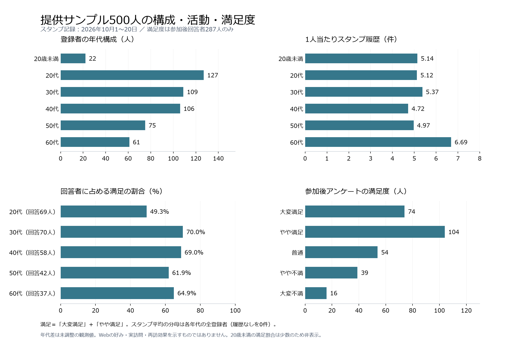
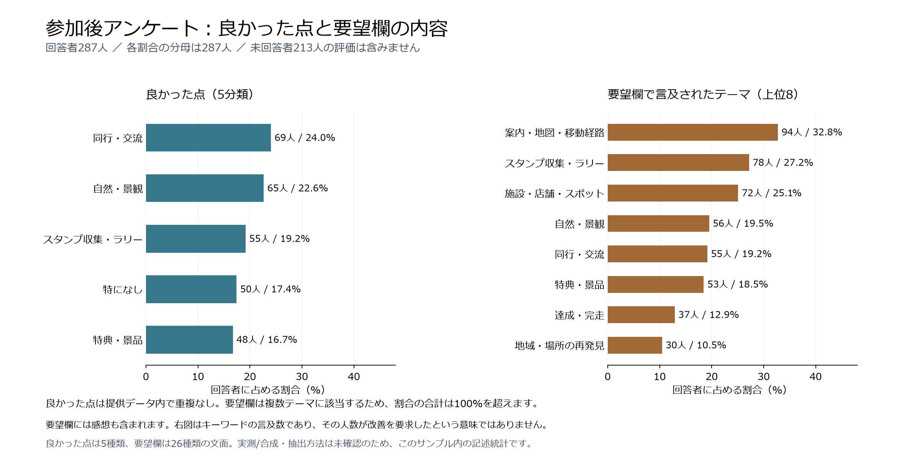

# 提供サンプルの利用傾向とアンケート分析

分析日：2026年11月9日。対象は `C:/AI-Sprint/sample-data` 直下の指定5CSV。記述統計・探索的分析であり、実測/合成等の由来、抽出方法、収録の完全性は未確認。外部の旅行者全体への推計ではない。

## 1. 対象と集計方法

| 入力 | 行数 | 異なる利用者数 |
|---|---:|---:|
| 13_ユーザー一覧.csv | 500 | 500 |
| 09_アンケート回答_登録時.csv | 500 | 500 |
| 08_アンケート回答_参加後.csv | 287 | 287 |
| 12_スタンプ獲得履歴.csv | 2,629 | 480 |
| 18_特典獲得履歴.csv | 584 | 355 |

利用者IDでメモリー内照合。氏名、メール、LINE IDでの結合はしない。元CSVは読み取り専用で、前後SHA-256が5件とも一致。全行重複、空ID、一覧に対応しないIDは0件。登録時と一覧の年代・性別は一致した。

スタンプ記録の期間は2026年10月1〜20日。平均スタンプの分母は各集団の全登録者で、提供履歴なしを0件と数える。実際に活動しなかったことや履歴の完全性を保証しない。満足割合は参加後の有効回答者のみを分母にし、「大変満足」「やや満足」を合算する。未回答を不満・0点にしない。

## 2. 年代・性別の傾向

| 年代 | 登録者 | 全500人に対する割合 | 平均スタンプ件数 | 参加後回答者 | 満足人数/回答者 | 満足割合 |
|---|---:|---:|---:|---:|---:|---:|
| 20歳未満 | 22 | 4.4% | 5.14 | 11 | 少数のため非表示 | — |
| 20代 | 127 | 25.4% | 5.12 | 69 | 34/69 | 49.3% |
| 30代 | 109 | 21.8% | 5.37 | 70 | 49/70 | 70.0% |
| 40代 | 106 | 21.2% | 4.72 | 58 | 40/58 | 69.0% |
| 50代 | 75 | 15.0% | 4.97 | 42 | 26/42 | 61.9% |
| 60代 | 61 | 12.2% | 6.69 | 37 | 24/37 | 64.9% |

20〜40代は342人、68.4%。60代は平均6.69件・中央値7件で、他の年代の平均4.72〜5.37件より多い。70歳以上の記録はなく、60代の結果を高齢者全般へ拡張しない。

20代の満足割合49.3%は30代70.0%より20.7ポイント低い。ただし、登録時期、参加条件、同行者、回答傾向等を調整していない観測差であり、年齢が原因とは断定しない。若者向けの見た目が不足している証拠でもない。理由を追加調査する候補として扱う。

| 性別（自己申告） | 登録者 | 平均スタンプ件数 | 満足人数/回答者 | 満足割合 |
|---|---:|---:|---:|---:|
| 男性 | 211 | 5.14 | 71/118 | 60.2% |
| 女性 | 284 | 5.29 | 104/165 | 63.0% |

その他・未回答の小集団の行動・評価は掲載しない。男性と女性のスタンプ平均差は約0.15件、満足割合差は約2.9ポイント（未丸め値から算出）。記述上は近いが、差がないという統計的な証明ではない。男女で色・機能の好みが異なるかは測定していない。

## 3. 活動の広がりと満足度

スタンプ記録がある人は480/500人（96.0%）。登録者1人当たり平均5.26件、中央値5件。異なるスポット名は7種類。履歴の件数と施設数は異なる指標である。

| スタンプ履歴件数 | 人数 | 登録者500人に対する割合 |
|---|---:|---:|
| 0件 | 20 | 4.0% |
| 1〜3件 | 128 | 25.6% |
| 4〜6件 | 174 | 34.8% |
| 7件以上 | 178 | 35.6% |

異なる2日以上に記録がある人は289/500人（57.8%）。これは別旅行や実際の再訪を確認した人数ではない。旅行IDや現地確認方法がないため、再訪率に言い換えない。

| 満足度 | 人数 | 回答者287人に対する割合 |
|---|---:|---:|
| 大変満足 | 74 | 25.8% |
| やや満足 | 104 | 36.2% |
| 普通 | 54 | 18.8% |
| やや不満 | 39 | 13.6% |
| 大変不満 | 16 | 5.6% |

満足は178/287人（62.0%）、不満は55/287人（19.2%）。参加後回答率は287/500人（57.4%）。

回答者のスタンプ平均は6.17件（中央値6件）、未回答者は4.03件（中央値3件）。活動の多い人が回答者に多く含まれるため、満足割合62.0%を全500人へ一般化しない。未回答者の満足度が低いとも断定できない。

回答者287人に限ったスタンプ件数と満足度のSpearman順位相関は−0.0707。強い単調関係は観測されず、スタンプ件数を満足度の代わりにしない。因果効果や無関係の証明ではない。

## 4. データ品質と読み取りの限界

- 一覧のスタンプ獲得数と履歴の行数は500人全員で一致した。
- **特典獲得数は227/500人（45.4%）で一覧と履歴が一致しない。** 本報告の特典584件・355人は履歴側の数値。期間差・取消・集計定義等の原因は不明。特典の利用・消費を確認した数でもない。
- 同じ人物の年代・性別は複数ファイル間で一致するが、本人情報の真正性までは保証しない。
- 探索的な年代差・性別差であり、抽出方法や実測/合成の由来が不明なため、母集団へのp値・信頼区間による主張は行わない。
- Webの見た目の好み、写真AIの精度、仲間提案の需要・効果、実旅行・再訪の増加は本CSVで測定していない。
- 小集団の詳細非表示は開示を減らす工夫であり、合計からの逆算防止を含む形式的な匿名化保証ではない。

## 5. 再現・独立確認

主集計：`scripts/analyze_audience_trends.py`。独立確認：`scripts/review_audience_trends.py`。いずれも指定CSVのみ読み込み、個人データを書き出さない。主集計の数値正本は `artifacts/audience-trends-summary.json`。日本語環境に依存しないようPythonの `-X utf8` を利用する。作図にはPJの既存Matplotlib環境を用いた。

5CSVの件数、年代・男女別人数/活動/満足、回答の有無別平均、特典不一致について独立計算が一致した。図の日本語・ラベル・数値の表示を目視確認した。分析対象の品質とアプリの実装品質は別で、C1評価点は加算しない。

関連チケット：T90。アンケート内容は次節に掲載する。

## 6. アンケート内容の統計

### 6.1 旅で良かった点（287人）

NFKC正規化と前後空白除去後の文面は5種類。テーマ辞書で各回答を分類すると、4テーマのいずれかにだけ該当する237人と「なし」50人となった。複数分類・未分類は0人。以下は重複なしで合計287人、100%。「特になし」は空欄や不満回答とは区別する。

分母：参加後回答者287人。

| 内容 | 人数 | 割合 |
|---|---:|---:|
| 同行・交流 | 69 | 24.0% |
| 自然・景観 | 65 | 22.6% |
| スタンプ収集・ラリー | 55 | 19.2% |
| 特になし | 50 | 17.4% |
| 特典・景品 | 48 | 16.7% |

同行・交流69人と自然・景観65人が上位。ただし差は4人にとどまり、交流が圧倒的な優先事項とは言えない。スタンプ55人、特典48人も記録されており、仲間機能だけの需要を示したものではない。

### 6.2 要望欄に書かれたテーマ（287人・複数分類）

各回答にテーマのキーワードがあるかを集計し、同じテーマは1回答につき1回だけ数えた。1回答が複数テーマに該当するため合計は100%を超える。全回答が少なくとも1テーマに該当し、空欄0・未分類0。ただし、これは意味分類の精度100%という意味ではない。

**この欄には感想・肯定表現も含まれる。下表は改善要求の人数ではなく、テーマへの言及人数である。**
分母：参加後回答者287人。

| 内容 | 人数 | 割合 |
|---|---:|---:|
| 案内・地図・移動経路 | 94 | 32.8% |
| スタンプ収集・ラリー | 78 | 27.2% |
| 施設・店舗・スポット | 72 | 25.1% |
| 自然・景観 | 56 | 19.5% |
| 同行・交流 | 55 | 19.2% |
| 特典・景品 | 53 | 18.5% |
| 達成・完走 | 37 | 12.9% |
| 地域・場所の再発見 | 30 | 10.5% |
| 交通・駐車 | 24 | 8.4% |
| アプリ・操作・通信 | 12 | 4.2% |
| 混雑・待ち時間 | 少数のため非表示 | — |
| 開催時期・期間 | 少数のため非表示 | — |
| 再参加・再訪・次回 | 少数のため非表示 | — |

要望欄の表現を追加確認した結果（重複なし、分母287人）：

| 内容 | 人数 | 割合 |
|---|---:|---:|
| 希望または困難の表現あり | 51 | 17.8% |
| 希望・困難表現がなく、肯定表現あり | 44 | 15.3% |
| 上記の表現辞書では未判定 | 192 | 66.9% |

ここでの希望・困難・肯定は明示的な語の有無による分類であり、人手で確認した要望件数や感情の正解ではない。未判定192人を「要望なし」としない。同一回答内のテーマと希望語の共起も、当該テーマへの改善要求とは確定できない。

テーマが多い案内・地図・経路などは、追加の聞き取りで「役立った点」「困った点」「改善したい点」を分けて確認する候補になる。現時点で94人が案内改善を要求したとは言えない。

### 6.3 何で知ったか（500人・複数選択）

セミコロンで選択肢を分割し、回答者ごとに同一選択肢を重複排除。未知選択肢0、空欄0、複数選択者191人、延べ選択数733。割合の分母は延べ733件ではなく回答者500人で、合計146.6%。
分母：登録時回答者500人。

| 内容 | 人数 | 割合 |
|---|---:|---:|
| 架空SNSの投稿 | 127 | 25.4% |
| 観光パンフレット | 120 | 24.0% |
| 友人からの紹介 | 127 | 25.4% |
| 観光案内所 | 115 | 23.0% |
| 旅の交流掲示板 | 116 | 23.2% |
| その他という回答 | 128 | 25.6% |

各経路は23.0〜25.6%で分散している。単独で支配的な集客経路はこの集計から見られない。元選択肢に「架空SNSの投稿」という表記があり、実在サービスの利用実績や実測調査とは断定しない。観光パンフレット名に含まれる地域名は表示を省略した。

### 6.4 職業と居住地域（各500人）

職業：辞書で広い区分にまとめ、重複なし・未分類0・未回答0。

| 内容 | 人数 | 割合 |
|---|---:|---:|
| 会社員・団体職員 | 236 | 47.2% |
| 公務員 | 47 | 9.4% |
| 自営業・自由業 | 76 | 15.2% |
| 学生 | 42 | 8.4% |
| 家事・育児・主婦・主夫・その他 | 55 | 11.0% |
| 無職・退職 | 44 | 8.8% |

居住地域：提供CSV内の地域ラベル。実在都道府県への対応は未確認。

| 内容 | 人数 | 割合 |
|---|---:|---:|
| 七色野地方 | 74 | 14.8% |
| 星凪地方 | 81 | 16.2% |
| 水琴地方 | 86 | 17.2% |
| 霧灯地方 | 107 | 21.4% |
| 雲風地方 | 78 | 15.6% |
| 青綴地方 | 74 | 14.8% |

職業の「家事・育児・主婦・主夫・その他」は異なる選択肢をまとめた区分であり、全員を同じ生活状況とみなさない。地域名から距離や都市/地方の違いを推定しない。

### 6.5 文面の集中・分類の限界・再現

良かった点は5種類の文面が全287回答を占める。要望欄は26種類、最多の同一文面27人、上位5文面で36.24%。自由な文章が287通りあるデータではなく、定型選択・合成等の生成方法が未確認である。文面の数を回答者数へ置き換えず、また同一文面を独立な需要の証拠として過大評価しない。

分類は正規表現によるキーワード一致。否定、対象、希望、感想の文脈を完全には判定できない。最初の辞書を実データで確認後に選択肢分割と語彙を補い、最終辞書を保存した探索的分析である。外部評価用の正解データで分類精度を検証したものではない。

集計：`scripts/analyze_survey_content.py`、数値正本：`artifacts/survey-content-summary.json`、作図・本節生成：`scripts/render_survey_summary.py`。元CSV2件の前後ハッシュ一致。認知経路の選択肢網羅・人数・延べ件数、良かった点の排他分類・合計287人は独立レビューでも確認した。氏名・ID・自由記述原文を出力しない。
